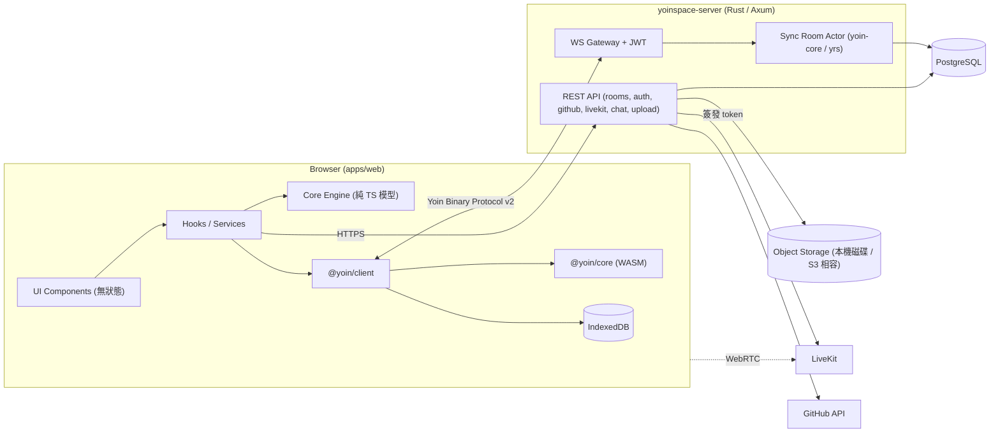
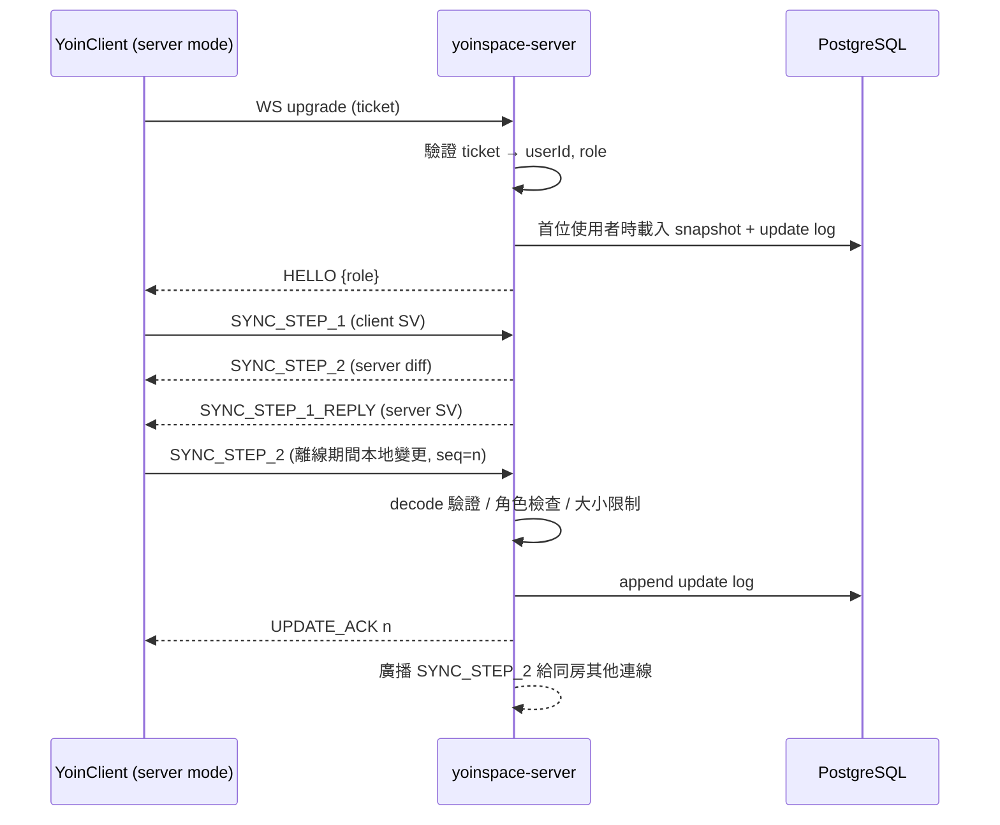
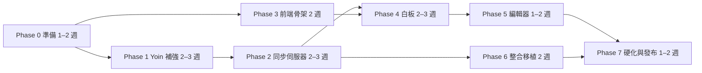

# 03 — YoinSpace 2.0 重構計畫

[← 回總覽](README.md)

> 本章假設採用 README 中的建議決策：D1=B→A、D2=A（Quill）、D3=B（不遷移）、D4=B（新 repo）、D5=A（Docker 自架）。若決策不同，需調整 §2、§3、§6。

---

## 1. 目標與非目標

**目標**

1. 以 Yoin 取代 Yjs，達成白板屬性級合併、字元級文字合併、離線編輯。
2. 以權威同步伺服器取代盲轉發，提供認證、權限、持久化、壓縮。
3. 遵守 `V2_RULES.md` 分層（Core Engine / UI / Hooks-Services / Config），單檔 ≤ 200 行、禁止 `any`。
4. 功能對等：房間、白板、文字協作、GitHub Issue 整合、聊天、語音。

**非目標（2.0 不做）**

- Tiptap/區塊式富文字編輯器（需 Yoin XmlFragment）
- 多節點水平擴展（Redis fan-out），2.0 先單節點
- V1 資料遷移
- 細粒度（段落級）RBAC；2.0 只有 owner / editor / viewer 房間角色

---

## 2. 目標架構



### 2.1 Repository 結構（新 repo `YoinSpace`）

```
yoinspace/
├── apps/
│   ├── web/                      # React + Vite
│   │   └── src/
│   │       ├── config/           # 常數、環境設定（Config 層）
│   │       ├── engine/           # Core Engine：純 TS，禁止 import React/DOM
│   │       │   ├── whiteboard/   # shape schema(Zod)、幾何、fractional index、命令
│   │       │   ├── editor/       # Quill Delta ↔ Yoin 轉換
│   │       │   └── board-zones/  # Kanban zone 命中判定
│   │       ├── services/         # Hooks/Services：yoin session、api client、livekit、github
│   │       ├── hooks/            # useRoomSession、useWhiteboard、useEditorBinding…
│   │       ├── features/         # 依功能組合 hooks + ui
│   │       │   ├── rooms/ whiteboard/ editor/ chat/ voice/ github/ admin/
│   │       └── ui/               # 無狀態元件（由 V1 外觀改寫）
│   └── server/                   # Rust workspace member：yoinspace-server
│       └── src/
│           ├── config.rs  auth/  rooms/  sync/  chat/  github/  livekit/  upload/
├── packages/
│   └── protocol/                 # 協定常數與錯誤碼（TS + Rust 由同一份定義產生）
├── infra/
│   └── docker-compose.yml        # server, web, postgres, livekit
└── docs/
```

Yoin 以 npm 套件（`@yoin/client`）與 Cargo 依賴（`yoin-core`，git 或 crates.io）引入，**不複製原始碼**。

---

## 3. 權威同步伺服器設計

### 3.1 Yoin Binary Protocol v2

沿用 1-byte header，保留 0–4 以相容既有 mesh 模式，新增 server 模式訊息：

| Code | 名稱 | 方向 | Payload | 說明 |
|---|---|---|---|---|
| 0 | `SYNC_STEP_1` | C→S | state vector | 既有 |
| 1 | `SYNC_STEP_2` | 雙向 | V1 update | 既有；C→S 時前綴 `u32 seq`（server 模式） |
| 2 | `SYNC_STEP_1_REPLY` | S→C | server state vector | 既有 |
| 3 | `AWARENESS` | 雙向 | JSON | 伺服器轉發前覆寫 `userId/name/avatar` |
| 4 | `JOIN_ROOM` | C→S | room id | 既有 |
| 16 | `HELLO` | S→C | JSON `{protocol:2, role, userId, serverTime}` | 認證通過後第一個訊息 |
| 17 | `UPDATE_ACK` | S→C | `u32 seq` | update 已套用且持久化 |
| 18 | `ERROR` | S→C | JSON `{code, message, seq?}` | `UNAUTHORIZED`、`FORBIDDEN_READONLY`、`INVALID_UPDATE`、`TOO_LARGE`、`RATE_LIMITED`、`ROOM_NOT_FOUND` |

認證：WebSocket 以 `Sec-WebSocket-Protocol: yoin.v2, bearer.<short-lived-ticket>` 傳遞一次性 ticket（由 REST `POST /api/rooms/:id/ticket` 取得，60 秒有效），避免長效 JWT 出現在 URL/日誌。

### 3.2 連線與同步流程



### 3.3 Room Actor

- 每個活躍房間一個 Tokio task（actor），持有 `yrs::Doc`；所有訊息經由 channel 序列化處理，無共享鎖。
- **持久化**：`room_updates(room_id, seq, data, created_at)` append-only；`room_snapshots(room_id, data, version)`。
- **壓縮**：update log 超過 500 筆或 1 MB、或房間閒置 60 秒 → 以 `encode_state_as_update_v1` 產生新 snapshot，刪除舊 log（單一 DB transaction）。
- **卸載**：房間無連線 5 分鐘後壓縮並釋放記憶體。
- **限制**：單一 update ≤ 1 MB、每連線 ≤ 60 update/s、awareness ≤ 30/s；超過回 `ERROR` 並視情況斷線。
- **一般房間 vs Pro 房間**：一般房間不寫 DB，最後一人離開即丟棄（保留 V1 產品語意）。

### 3.4 業務 API（REST）

| 群組 | 端點範例 | 來源 |
|---|---|---|
| auth | `POST /api/auth/guest`、`GET /api/auth/github/*`、`POST /api/auth/refresh` | V1 register/OAuth 重新設計：guest 帳號 + GitHub 帳號 |
| rooms | `POST/GET/DELETE /api/rooms`、`POST /api/rooms/:id/join`（密碼 → Argon2 驗證）、`POST /api/rooms/:id/ticket` | V1 rooms |
| github | issues、comments、state、labels（以使用者 OAuth token 代理） | 移植 `github*.go` |
| livekit | `GET /api/rooms/:id/voice-token` | 移植 `livekit.go` |
| chat | `GET /api/rooms/:id/messages`、WS 子通道或獨立 `/ws/chat` | 重寫 |
| upload | `POST /api/rooms/:id/assets` → 回傳 URL | 新增（取代 Data URL） |
| admin | 房間觀測（在線人數、doc 大小、update log 長度） | V1 Dashboard |

> [!NOTE]
> D1=B 時，第 2–5 階段可讓 Rust 伺服器只負責 `/ws/sync` 與 `rooms/ticket`，其餘 REST 暫由 Go 提供（共用 JWT secret 與 PG），於 Phase 6 移植完成後移除 Go。

---

## 4. 資料模型（Yoin 文件 Schema）

每個房間一份 Yoin 文件：

| 根容器 | 型別 | 內容 |
|---|---|---|
| `wb.shapes` | Map<shapeId, **YMap**> | 每個圖形是巢狀 YMap：`type, x, y, w, h, r, rotation, fill, stroke, strokeWidth, points, text, fontSize, assetUrl, z, createdBy` |
| `wb.widgets` | Map<widgetId, **YMap**> | GitHub Issue Widget：`issueRef{owner,repo,number}, x, y, w, h, z, createdBy`（Issue 內容不進 CRDT，由 API 快取取得） |
| `wb.zones` | Map<zoneId, YMap> | Kanban zone 定義（可選，預設由 config 提供） |
| `doc.main` | Text（含格式屬性） | 共享文件，Quill Delta |
| `meta` | Map | 房間顯示名稱、schema 版本 `schemaVersion: 1` |

規則：

1. **禁止**以 `setMap(root, id, object)` 寫入圖形；一律透過 engine 命令 → Yoin 巢狀 API。
2. `z` 使用 fractional index 字串，避免 `Date.now()` 衝突與 Array move。
3. `points` 在筆畫完成時一次寫入（陣列值為原子值即可）；繪製中透過 Awareness 暫態廣播。
4. 每個容器在 engine 層有 Zod schema，讀取時做防禦性解析（未知/損壞的 shape 略過並記錄）。

---

## 5. 前端分層對照（V1 → V2）

| V1 | 問題 | V2 拆分 |
|---|---|---|
| `useYjsConnection.ts` | 生命週期、awareness、重連混在一起 | `services/yoinSession.ts`（建立/銷毀 client、ticket 取得）＋ `hooks/useRoomSession.ts`（React 綁定）；重連交給 Yoin |
| `Editor.tsx` | LWW | `engine/editor/deltaBinding.ts`（Quill delta ↔ Yoin）＋ `hooks/useEditorBinding.ts` ＋ `ui/EditorView.tsx` |
| `Whiteboard.tsx` (1207 行) | UI/狀態/同步/鍵盤/貼上/縮放全在一檔 | `engine/whiteboard/{schema,commands,geometry,zIndex}.ts`、`hooks/{useWhiteboardShapes,useCanvasViewport,useWhiteboardTools,useShortcuts,usePasteAsset}.ts`、`ui/whiteboard/{Toolbar,ShapeLayer,CursorLayer,…}.tsx` |
| `GitHubContext.tsx` (556 行) | 全域 Context 承擔 API、快取、OAuth | `services/githubApi.ts`、`hooks/useIssues.ts`、`hooks/useGitHubAuth.ts` |
| `App.tsx` (356 行) | 手寫 view 切換 + 所有連線 | Router（`/`, `/rooms/:id`, `/admin`）＋ feature 頁面 |
| `config/constants.ts` | 部分硬編碼散落各處 | 全部集中 `config/`，以 `import.meta.env` + Zod 驗證 |

---

## 6. 階段計畫



| Phase | 內容 | 完成定義（DoD） |
|---|---|---|
| **0 準備** | 確認 D1–D5；建立 YoinSpace repo 骨架與 CI；SyncSpace 打 `v1.0-final` tag；撰寫功能對等驗收清單（由 01 §1.3 展開） | repo 可 `pnpm dev` / `cargo run`；CI 跑 lint + typecheck + test；驗收清單經確認 |
| **1 Yoin 補強** | 完成 04 清單 Yoin P0（Y-01～Y-06）並發布 `@yoin/client` 0.2.0 / `yoin-core` 0.2.0 | 每項有真實 WASM 測試；兩客戶端經 mock server 收斂測試通過；CHANGELOG 記錄破壞性變更 |
| **2 同步伺服器** | Axum WS gateway、ticket 驗證、Room Actor、PG 持久化與壓縮、限流、admin metrics | 整合測試：多客戶端收斂、斷線重送 ACK、伺服器重啟後資料完整、viewer 寫入被拒、超大封包被拒 |
| **3 前端骨架** | Router、登入（guest/GitHub）、房間列表/建立/密碼加入、`useRoomSession`、連線/同步狀態 UI、Config 層 | 可建立房間並看到 HELLO 與 online 狀態；無 `any`；單檔 ≤ 200 行 |
| **4 白板** | engine 模型、工具（rect/circle/pen/arrow/text/image）、Transformer、縮放平移、游標與筆跡 Awareness、Undo/Redo、圖片上傳、Issue Widget + Kanban zone | 雙客戶端並發「移動 vs 改色」皆保留；離線編輯後重連收斂；500 物件拖曳維持 ≥ 50 FPS |
| **5 編輯器** | Quill + delta binding、遠端 delta 套用保留本地游標、Relative Position 游標（Y-07） | 雙客戶端同位置並發輸入無遺失；Undo 只撤銷自己的操作 |
| **6 整合移植** | 聊天（伺服器權威）、LiveKit 語音/螢幕分享、GitHub issues/comments/state、Admin Dashboard；D1=B 時移除 Go | 01 §1.3 功能清單全數通過驗收 |
| **7 硬化與發布** | 安全基線（04 §2.3）、Playwright E2E、負載測試、部署文件、`docker compose up` 一鍵啟動 | E2E 綠燈；50 人單房負載測試通過；README/部署文件完成；tag `v2.0.0` |

---

## 7. 風險與對策

| 風險 | 機率 | 影響 | 對策 |
|---|---|---|---|
| Yoin API 在 YoinSpace 開發期間頻繁變動 | 高 | 中 | Phase 1 先凍結 0.2 API；YoinSpace 透過 `services/` 單點封裝 Yoin，變更只改一處 |
| 遠端變更事件（Y-03）實作複雜，Yrs observer 在 WASM 生命週期中難以管理 | 中 | 高 | 先以「transaction 後回傳變更根容器名稱」的簡化版完成，delta 事件第二步再做 |
| Quill 綁定在遠端更新時游標跳動 | 中 | 中 | 使用 Quill `updateContents(delta, 'api')` 套用增量而非 `setContents`；Y-07 後改用 Relative Position |
| Rust 後端學習/移植成本超出預期 | 中 | 高 | 採 D1=B：先只做同步伺服器，業務 API 暫留 Go |
| WASM 載入/體積影響首屏 | 低 | 低 | WASM 約 236 KB；路由層 lazy load 房間頁面 |
| 伺服器 Doc 長期增長 | 中 | 中 | 壓縮機制 + admin 監看 doc 大小；必要時設定房間大小上限 |
| 範圍蔓延（同時想做 Tiptap、子文件） | 中 | 中 | 嚴格依 §1 非目標；新功能進 2.x backlog |

