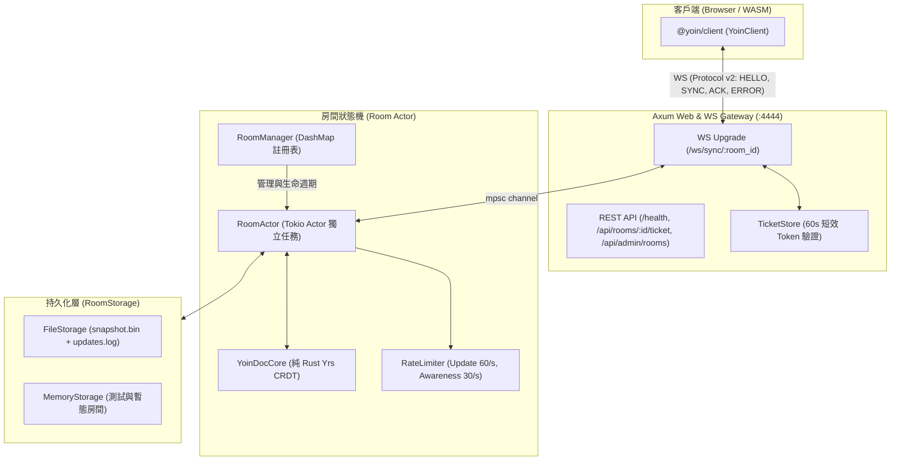

# 06 — 權威同步伺服器 (crates/yoin-sync-server) 實作報告

[← 回總覽](README.md)

---

## 1. 架構總覽

`yoin-sync-server` 是 YoinSpace 2.0 的中央權威同步節點（Authoritative Sync Server），採用 Rust + Axum + Tokio 構建，直接依賴純 Rust 的 `crates/yoin-core`。

伺服器負責：
1. **單一事實來源（Single Source of Truth）**：每間活躍房間由獨立的 Tokio Actor 任務持有 `YoinDocCore`，所有變更經由序列化通道處理，無跨執行緒共享互斥鎖。
2. **全域順序編號與確認（Seq & ACK）**：每個寫入分配嚴格遞增的 `seq`，並向發送端回傳 `MSG_UPDATE_ACK`。
3. **安全存取控制與防禦**：驗證一次性短效憑據（Ticket）、阻擋 `viewer` 唯讀角色寫入、限制封包大小（≤ 1MB）、Token Bucket 頻率限制、Awareness 身分防偽。
4. **歷史壓縮與持久化（Compaction & Storage）**：日誌追加寫入（Append-only），累積 500 筆更新、1MB 或閒置時壓縮成合併快照（Snapshot）。

---

## 2. Protocol v2 封包協定實作

協定沿用 1-byte opcode 前綴，完整支援雙向通訊：

| Opcode | 常數名 | 方向 | Payload 結構 | 處理邏輯 |
|---|---|---|---|---|
| `0` | `MSG_SYNC_STEP_1` | C → S | `[client_state_vector]` | 伺服器以 `doc.export_diff(sv)` 計算伺服器增量，並以 `MSG_SYNC_STEP_2` 回覆；接著回傳伺服器現況 State Vector（`MSG_SYNC_STEP_1_REPLY`）。 |
| `1` | `MSG_SYNC_STEP_2` | 雙向 | C → S: `[u32_be seq, ...update]` S → C: `[...update]` | **客戶端至伺服器**：帶有客戶端 sequence。伺服器檢查頻率、角色、封包大小後寫入 `YoinDocCore`，回傳 `UPDATE_ACK`，並將二進位增量廣播給房內其他客戶端。 |
| `2` | `MSG_SYNC_STEP_1_REPLY` | S → C | `[server_state_vector]` | 告知客戶端伺服器目前的 State Vector。 |
| `3` | `MSG_AWARENESS` | 雙向 | `[json_utf8]` | 伺服器攔截並以驗證過的 `userId` 與 `name` 強制覆寫 JSON 欄位，防止冒名偽造，再廣播給其他連線。 |
| `4` | `MSG_JOIN_ROOM` | C → S | `[room_id_utf8]` | 請求加入特定房間。 |
| `16` | `MSG_HELLO` | S → C | `{"protocol":2, "role": "...", "userId": "...", "serverTime": ...}` | 認證通過並建立連線後，伺服器向客戶端主動發出的第一個訊息。 |
| `17` | `MSG_UPDATE_ACK` | S → C | `[u32_be seq]` | 確認特定 `seq` 的變更已成功套用至權威文件並完成持久化。 |
| `18` | `MSG_ERROR` | S → C | `{"code": "...", "message": "...", "seq": ...}` | 錯誤代碼：`FORBIDDEN_READONLY`、`TOO_LARGE`、`INVALID_UPDATE`、`RATE_LIMITED`、`UNAUTHORIZED`。 |

---

## 3. 安全防禦與存取控制機制

1. **短效 Ticket 機制（Ticket-based Auth）**：
   - 前端透過 `POST /api/rooms/:id/ticket` 申請短效連線憑據（預設 60 秒有效）。
   - WebSocket 連線於交握階段以 `Sec-WebSocket-Protocol: yoin.v2, bearer.<ticket>` 傳遞（亦支援 `?ticket=` 查詢參數）。
   - 伺服器核對房號無誤後銷毀（一次性或限定 TTL），避免長期 JWT 暴露在 URL 或代理伺服器日誌。
2. **角色權限隔離（Role Enforcement）**：
   - 角色為 `viewer` 的客戶端若嘗試發送 `MSG_SYNC_STEP_2` 寫入，Room Actor 即時攔截並回覆 `ERROR: FORBIDDEN_READONLY`，拒絕套用變更。
3. **大小與格式校驗（Payload Validation）**：
   - 單筆 update 超過 1MB 即回傳 `ERROR: TOO_LARGE`。
   - 損壞或非 Yrs 二進位資料在 `doc.apply_update` 失敗時即時回傳 `ERROR: INVALID_UPDATE`，保證伺服器文件狀態完好無損。
4. **Token Bucket 限流（Rate Limiting）**：
   - 每個連線獨立維護限流桶：Update 上限 60/s；Awareness 上限 30/s。超過直接拒絕或丟棄暫態廣播，防止廣播風暴。
5. **Awareness 身分防偽（Identity Sanitization）**：
   - 伺服器轉發暫態游標與在線狀態前，自動將 payload 內的 `userId`、`clientId`、`name` 替換為 Ticket 簽發身分，防止偽造他人游標。

---

## 4. 持久化與壓縮架構 (Compaction)

伺服器定義 `RoomStorage` async trait，提供可插拔儲存引擎：
- `MemoryStorage`：純記憶體存放，適用於暫態房間與自動化測試。
- `FileStorage`：基於磁碟目錄結構的零依賴檔案儲存：
  - `rooms/{room_id}/snapshot.bin`：Consolidated snapshot 快照檔（原子覆寫）。
  - `rooms/{room_id}/updates.log`：Append-only 二進位更新日誌，格式為 `[seq: u32_be][len: u32_be][bytes...]`。
- **Compaction 觸發時機**：
  - 更新筆數累積達到 500 筆；
  - 更新位元組累積達到 1 MB；
  - 房間無人在線且閒置超過 60 秒；
  - 伺服器收到關機訊號（Graceful Shutdown）時主動壓縮並寫入快照。

---

## 5. 測試驗證矩陣

### 5.1 Rust 單元測試 (`cargo test -p yoin-sync-server`)
- `auth::tests::test_create_and_validate_ticket`：票據簽發、單次消耗與驗證通過。
- `auth::tests::test_room_mismatch_rejected`：跨房間票據拒絕連線。
- `auth::tests::test_extract_subprotocol_token`：子協定標頭抽取正確。
- `protocol::tests::test_parse_sync_step_1` / `test_parse_sync_step_2_server_mode`：二進位解析。
- `protocol::tests::test_encode_ack` / `test_encode_error` / `test_encode_and_parse_hello`：編碼回傳格式一致。
- `rate_limiter::tests::test_rate_limiter_burst_and_exhaust`：突發限制與冷卻恢復。
- `storage::tests::test_memory_storage_lifecycle` / `test_file_storage_lifecycle`：快照、增量讀寫與壓縮重置。

### 5.2 端到端整合測試 (`crates/yoin-sync-server/tests/server_integration.rs`)
測試覆蓋真實本機 Axum WebSocket 伺服器連線：
1. `test_multi_client_convergence_and_ack`：雙客戶端連線、Alice 寫入、伺服器 ACK 確認、Bob 接收廣播並收斂至一致內容。
2. `test_viewer_read_only_mutation_rejection`：`viewer` 寫入遭拒絕並返回 `FORBIDDEN_READONLY`。
3. `test_oversize_update_rejection`：> 1MB 封包遭拒絕並返回 `TOO_LARGE`。
4. `test_corrupted_crdt_binary_rejection`：無效二進位資料遭拒絕並返回 `INVALID_UPDATE`。
5. `test_server_restart_persistence_and_sync_step_1`：伺服器 A 寫入資料後關閉，伺服器 B 啟動讀取同一儲存目錄，新連線透過 `SYNC_STEP_1` 完整還原資料。
6. `test_ticket_auth_subprotocol_header_and_rejection`：測試 `Sec-WebSocket-Protocol` 標頭驗證與無效憑據 401 拒絕。

### 5.3 跨語言與單元回歸現狀
- **Rust Workspace**：20 passed, 0 failed.
- **Client Vitest**：138 passed, 0 failed.
- **Monorepo Integrity**：56 passed, 0 failed.

