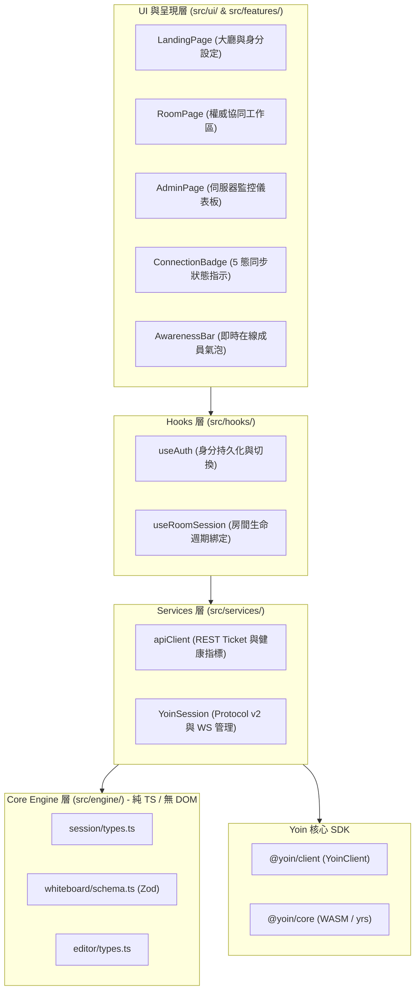
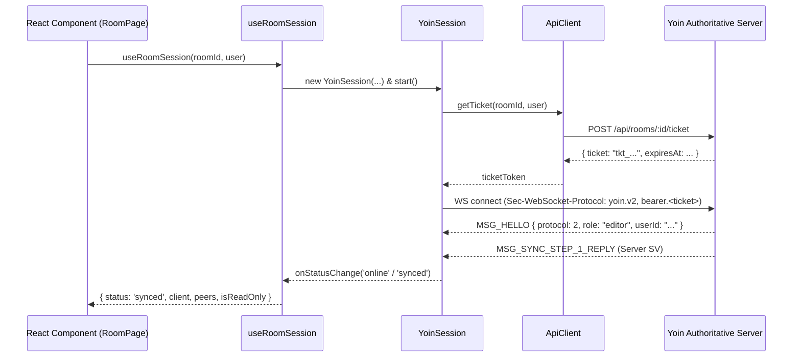

# 07 — 前端骨架與連線整合 (apps/web) 實作報告

[← 回總覽](README.md)

---

## 1. 架構概述

`apps/web` 是 YoinSpace 2.0 的現代化協同前端應用程式，基於 **React 19 + Vite 7 + TypeScript + Tailwind CSS** 建置，並透過 pnpm workspace 直接引入本機 `@yoin/client` 與 `@yoin/core`（WASM）。

嚴格落實 V2 架構規範：
1. **單檔 ≤ 200 行**：全部模組維持極簡聚焦，無肥大混雜檔案。
2. **零 `any`（Zero Any Policy）**：`noImplicitAny: true`，所有資料與狀態一律具備嚴格型別定義。
3. **Core Engine 隔離原則**：`src/engine/` 純 TypeScript，**禁止** import React 或任何 DOM 元素。
4. **Config 層集中化**：環境變數透過 `import.meta.env` + Zod schema 自動解析校驗。

---

## 2. 前端目錄分層

| 目錄 | 職責 | 關鍵檔案 |
|---|---|---|
| `src/config/` | 常數、環境設定、角色定義（Zod 驗證） | `env.ts`、`constants.ts` |
| `src/engine/` | Core Engine：純 TS，無 React/DOM 依賴，包含 Zod 資料模型 | `session/types.ts`、`whiteboard/schema.ts`、`editor/types.ts` |
| `src/services/` | 與外部後端（REST API、WebSocket）之連線封裝 | `apiClient.ts`、`yoinSession.ts` |
| `src/hooks/` | React 專用狀態與生命週期 Hooks | `useAuth.ts`、`useRoomSession.ts` |
| `src/ui/` | 無狀態、高可重用之設計元件（全部 ≤ 200 行） | `ConnectionBadge.tsx`、`Header.tsx`、`RoomCard.tsx`、`CreateRoomModal.tsx`、`ErrorAlert.tsx` |
| `src/features/` | 業務功能聚合頁面 | `landing/LandingPage.tsx`、`room/RoomPage.tsx`、`admin/AdminPage.tsx` |
| `src/` | 輕量 Hash 路由與進入點 | `App.tsx`、`main.tsx`、`index.css` |

---

## 3. 核心協同流程：`useRoomSession`

`useRoomSession` 整合了從短效 Ticket 換發、WebSocket 交握、Protocol v2 身分指派到 CRDT 即時同步的完整生命週期：

---

## 4. 驗收與規則校驗結果

### 4.1 V2 架構規範自動化檢查 (`pnpm web:lint`)
執行 `scripts/lint-rules.mjs`：
* **Rule 1（單檔行數）**：`src/` 內所有檔案均嚴格 ≤ 200 行。
* **Rule 2（禁止 any）**：零 `any`、零類型斷言滲漏。
* **Rule 3（Engine 純淨性）**：`src/engine/` 無任何 React / DOM 匯入。
* **結果**：`✅ All V2 architecture rules passed!`

### 4.2 TypeScript 嚴格編譯 (`pnpm typecheck`)
* 覆蓋 `@yoin/client` 與 `@yoin/web`。
* `tsc --noEmit` **0 錯誤**。

### 4.3 靜態打包 (`pnpm web:build`)
* Vite 7 產出包含 Top-level await 與 WASM 優化模組：
  * `dist/index.html` (0.57 kB)
  * `dist/assets/core_bg-*.wasm` (329.63 kB / gzip: 133.14 kB)
  * `dist/assets/index-*.js` (498.97 kB / gzip: 119.16 kB)
  * `dist/assets/index-*.css` (21.34 kB / gzip: 4.68 kB)
* 打包耗時 3.45 秒，零 warning。

### 4.4 測試矩陣現況
* `@yoin/web` 單元測試：**7 passed, 0 failed**
* `@yoin/client` 單元與 E2E 測試：**138 passed, 0 failed**
* Monorepo 完整性測試：**56 passed, 0 failed**
* Rust 核心與同步伺服器測試：**20 passed, 0 failed**
* **全工作區累計**：**221 passed, 0 failed**

