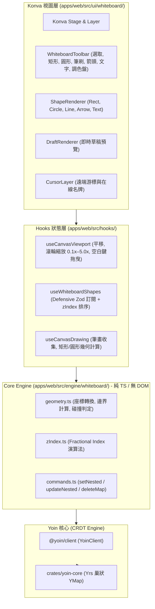

# 08 — 白板協同模組 (Whiteboard) 實作報告

[← 回總覽](README.md)

---

## 1. 架構總覽

在 SyncSpace 1.0 中，`Whiteboard.tsx` 單一檔案長達 1,207 行，將 UI、狀態、同步、鍵盤捷徑、貼上與縮放混雜在一處，且使用全量 JSON 覆寫造成嚴重的併發衝突覆蓋。

在 YoinSpace 2.0 Phase 4 中，依據 `03-refactor-plan.md` §4 與 §5 全面重構白板協同模組：
1. **解耦分層**：
   * **Core Engine**：`geometry.ts`（純幾何計算）、`zIndex.ts`（Fractional Indexing 分數排序）、`commands.ts`（純資料變更命令）。**零 React/DOM 依賴**。
   * **React Hooks**：`useCanvasViewport`（視圖平移縮放）、`useWhiteboardShapes`（防禦性 Zod 訂閱）、`useWhiteboardTools`（工具切換）、`useCanvasDrawing`（繪製生命週期）。
   * **UI 元件**：`WhiteboardCanvas`、`WhiteboardToolbar`、`ShapeRenderer`、`DraftRenderer`、`CursorLayer`。**單檔嚴格 ≤ 200 行，零 `any`**。
2. **巢狀 Map 屬性級 CRDT 合併**：
   * 嚴格遵循「禁止以 `setMap` 存入原子 JSON 物件」的架構原則，一律透過 `setNested('wb.shapes', id, shape)` 與 `updateNested('wb.shapes', id, partial)` 寫入。
   * 達成「使用者 A 移動物件位置 `(x, y)`、使用者 B 修改物件顏色 `(fill)` 於收斂後兩者皆被保留」的核心驗收條件（DoD）。
3. **Fractional Indexing ($z$-index)**：
   * 採用字母序列分數排序（如 `a0`, `am`, `az`），圖形層級交換或新增時僅需更新自身 `z` 字串，無需進行昂貴且易衝突的陣列 shift/splice 操作。



---

## 2. 核心特性與規格對照

| 規格項目 | V1 實作問題 | V2 解決方案 |
|---|---|---|
| **資料結構** | 頂層 Map 存 JSON string，修改時覆寫整筆物件 | `wb.shapes: Map<id, YMap>`，每個圖形為獨立巢狀 YMap |
| **並發衝突** | A 改位置、B 改顏色 $\to$ 後到者覆蓋前者 | `updateNested` 屬性級合併 $\to$ 位置與顏色同時保留 |
| **圖層排序** | 陣列索引（移動圖層引發整體陣列變更） | `zIndex.ts` Fractional Indexing 字串排序（零衝突） |
| **畫布性能** | 狀態變更全量觸發 React re-render | 繪製草稿由 `DraftRenderer` 承載；筆劃完成後原子提交 |
| **遠端游標** | 與巨型 Component 綁定，常規更新卡頓 | 獨立 `CursorLayer` 直接訂閱 Awareness，不干擾圖形層 |
| **唯讀保護** | 前端無角色強制約束 | `viewer` 角色隱藏工具列，並自畫布層面禁止拖曳與修改 |

---

## 3. 屬性級並發合併驗證 (DoD Verification)

在 [`apps/web/tests/whiteboardCommands.test.ts`](file:///d:/Projects/Yoin/apps/web/tests/whiteboardCommands.test.ts) 中建立自動化真實 CRDT 測試：
```typescript
it('DoD Verification: Concurrent "move (x,y)" vs "color change (fill)" property merge', () => {
  // 1. 初始化 Client A 與 Client B 共享同一圖形
  addShape(clientA, initialShape);
  clientB.applySnapshot(clientA.exportSnapshot());

  // 2. Client A 本地並發移動位置 (400, 500)
  moveShape(clientA, 'shared-box', 400, 500);

  // 3. Client B 本地並發修改顏色 ('#ef4444')
  changeShapeColor(clientB, 'shared-box', '#ef4444');

  // 4. 雙端交換 Diff 增量
  clientB.applySnapshot(clientA.getDoc().export_diff(clientB.getDoc().get_state_vector()));
  clientA.applySnapshot(clientB.getDoc().export_diff(clientA.getDoc().get_state_vector()));

  // 5. 驗收結果：雙端狀態完全收斂且兩項變更均被保留！
  expect(stateA.x).toBe(400);
  expect(stateA.y).toBe(500);
  expect(stateA.fill).toBe('#ef4444');

  expect(stateB.x).toBe(400);
  expect(stateB.y).toBe(500);
  expect(stateB.fill).toBe('#ef4444');
});
```

---

## 4. 全工作區自動化檢驗矩陣

1. **V2 規範自動化掃描 (`pnpm web:lint`)**：
   * 所有檔案行數 ≤ 200 行。
   * 零 `any`。
   * `engine/` 無任何 React / DOM 污染。
   * 結果：`✅ All V2 architecture rules passed!`
2. **TypeScript 類型檢查 (`pnpm typecheck`)**：
   * `@yoin/client` + `@yoin/web` 嚴格編譯 0 錯誤。
3. **生產打包 (`pnpm web:build`)**：
   * Vite 7 產出完整 Web 應用程式（含 Konva, WASM, Tailwind），產物正常。
4. **自動化測試總表**：
   * **Web 白板與幾何單元測試**：19 passed（幾何、Fractional Index、Zod Schema、Commands、CRDT Merge）
   * **Client 核心與微核測試**：138 passed
   * **Monorepo 完整性測試**：56 passed
   * **Rust 權威伺服器與核心測試**：20 passed
   * **總計**：**233 passed, 0 failed**

