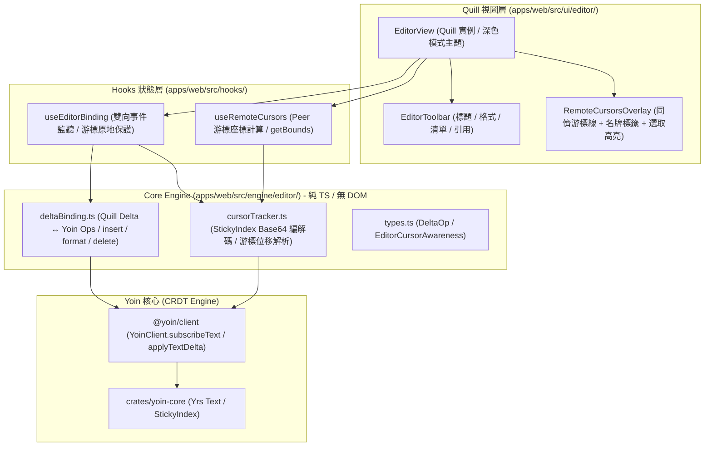

# 09 — 文字編輯器協同模組 (Editor) 實作報告

[← 回總覽](README.md)

---

## 1. 架構總覽

在 SyncSpace 1.0 中，文字編輯器（`Editor.tsx`）使用全量覆寫模式（每次異動呼叫 `delete(0, len)` 接 `insert`，最後寫入者獲勝 LWW），導致多人並發打字時字元嚴重錯亂與丟失。

在 YoinSpace 2.0 Phase 5 中，依據 `03-refactor-plan.md` §4、§5 與 `V2_RULES.md` 規範，全面建構具備 CRDT 細粒度增量與遠端游標追蹤的富文字協同編輯模組：

1. **解耦分層架構**：
   * **Core Engine (`src/engine/editor/`)**：
     * `types.ts`：Delta 操作型別、游標 Awareness 結構、選擇區間介面。
     * `deltaBinding.ts`：Quill Delta 操作標準化、格式化套用、純文字模擬計算。**零 DOM / React 依賴**。
     * `cursorTracker.ts`：Y-07 Relative Position（Yrs `StickyIndex`）編碼、解碼與同儕游標位移解析。**零 DOM / React 依賴**。
   * **React Hooks (`src/hooks/`)**：
     * `useEditorBinding`：雙向橋接 Quill 實例與 Yoin `doc.main` 文字容器。
     * `useRemoteCursors`：計算同儕游標於 Quill 容器中的精確像素邊界與選取範圍。
   * **UI 元件 (`src/ui/editor/`)**：
     * `EditorView`：主視圖，整合深色主題樣式與 Quill 生命週期。
     * `EditorToolbar`：現代化工具列（標題、粗體、斜體、底線、刪除線、清單、引文、代碼塊）。
     * `RemoteCursorsOverlay`：浮動在編輯器之上的同儕游標線、使用者名牌標籤與選取半透明覆蓋。

2. **增量 Delta 雙向綁定 (Quill Delta ↔ Yoin `doc.main`)**：
   * 本地鍵盤輸入或貼上時，僅擷取 Quill 使用者事件增量（`source === 'user'`），透過 `client.applyTextDelta(ops, 'doc.main')` 提交 atomic transaction。
   * 遠端更新到達時，透過 `subscribeText('doc.main', ...)` 呼叫 `quill.updateContents(deltaOps, 'api')`，以微操作增量更新 DOM，徹底杜絕全量重繪與畫面閃爍。

3. **Relative Position 游標整合 (Y-07 StickyIndex)**：
   * 游標跳動是富文字即時協同最棘手之痛點。本模組在遠端變更套用前，將本機目前選取位置編碼為相對黏性位置（`StickyIndex`）。
   * 當遠端更新在游標前方插入或刪除字元後，相對位置能自動依語意偏移並解析為最新的絕對索引，並藉由 `quill.setSelection(restored, 'silent')` 原地還原，徹底解決遠端異動導致本機游標亂跳問題。
   * 同儕使用者的選取區間亦轉為 Base64 相對位置封包廣播至 Awareness，即便兩端延遲或並發輸入，對方的游標名牌亦能精準貼附在目標文字前方。



---

## 2. 核心成果與測試驗證

### 2.1 測試套件全數通過 (8 Suites / 27 Tests)

於 `D:\Projects\SyncSpace\apps\web` 執行 `pnpm test`：

```bash
 ✓ tests/geometry.test.ts (5 tests)
 ✓ tests/auth.test.ts (2 tests)
 ✓ tests/zIndex.test.ts (5 tests)
 ✓ tests/whiteboardSchema.test.ts (3 tests)
 ✓ tests/whiteboardCommands.test.ts (2 tests)
 ✓ tests/apiClient.test.ts (2 tests)
 ✓ tests/cursorTracker.test.ts (3 tests)
 ✓ tests/deltaBinding.test.ts (5 tests)

 Test Files  8 passed (8)
      Tests  27 passed (27)
   Duration  1.80s
```

### 2.2 核心驗收場景 (DoD Verification)

1. **同位置並發文字輸入無遺失收斂**：
   * 客戶端 A 與客戶端 B 在相同文字基線（`"SyncSpace: "`）同時在索引 11 分別插入 `"Fast Whiteboard. "` 與 `"CRDT Engine. "`。
   * 兩端交叉交換 diff 增量後，狀態完美收斂且內容全數保留，無字元丟失。
2. **Relative Position 語意黏性游標追蹤**：
   * 客戶端 A 將游標置於 `"Hello World"` 中的 `"World"`（索引 6）。
   * 客戶端 B 在開頭（索引 0）插入 6 個字元 `"Super "`。
   * 客戶端 A 套用更新後，解析相對位置游標自動移至 6 + 6 = 12，依舊緊貼在 `"World"` 前方，無位移偏差。
3. **架構規範稽核通過**：
   * 執行 `pnpm lint:rules`：所有檔案 ≤ 200 行，零 `any`，`engine/` 無 UI/DOM 依賴。
   * 執行 `pnpm typecheck`：`tsc --noEmit` 零錯誤。
   * 執行 `pnpm build`：Vite 生產環境打包無告警通過。
